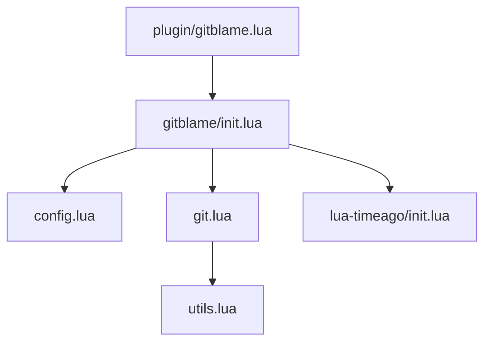

# f-person/git-blame.nvim

> Neovim plugin in Lua that shows the commit author of the current line as virtual text.

## The problem
Finding out who wrote a line means running git blame outside the editor.

## What it actually does
Queries git for the line under the cursor and shows author, date and summary according to a template. Commands to copy the SHA, the commit or file URL, or open the commit in the browser. Functions for the status line (lualine). Relative dates via lua-timeago.

## How it is wired


## Trying it
```vim
Plug 'f-person/git-blame.nvim'
```
Command: `:GitBlameToggle`.

## Cost and gotchas
Free. Neovim 0.5 or later and git required. `:GitBlameCopyPRURL` requires the `gh` CLI. Last push dates back more than a year.

## What it is not
Not a full history tool: only the current line.

## Alternatives
coc-git, cited as a source of inspiration.

## For you
Ignore: editor comfort, no effect on your data / AI / MLOps work. Useful only if you live in Neovim.
