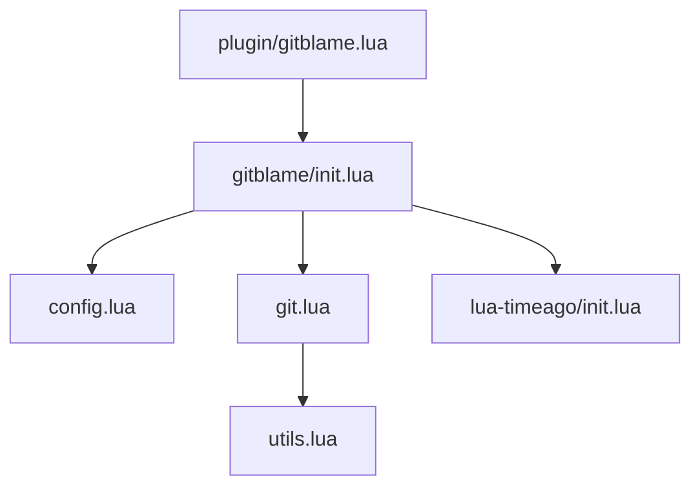

# f-person/git-blame.nvim

> Plugin Neovim en Lua qui affiche l'auteur du commit de la ligne courante, en texte virtuel.

## Le problème
Savoir qui a écrit une ligne oblige à lancer git blame hors de l'éditeur.

## Ce que ça fait vraiment
Interroge git pour la ligne sous le curseur et affiche auteur, date et résumé selon un gabarit. Commandes pour copier le SHA, l'URL du commit ou du fichier, ou ouvrir le commit dans le navigateur. Fonctions pour la ligne d'état (lualine). Dates relatives via lua-timeago.

## Comment c'est branché


## Essayer
```vim
Plug 'f-person/git-blame.nvim'
```
Commande : `:GitBlameToggle`.

## Coût et pièges
Gratuit. Neovim 0.5 ou plus et git requis. `:GitBlameCopyPRURL` exige la CLI `gh`. Dernier push remontant à plus d'un an.

## Ce que ce n'est pas
Pas un outil d'historique complet : seulement la ligne courante.

## Alternatives
coc-git, cité comme source d'inspiration.

## Pour toi
Ignorer : confort d'éditeur, sans effet sur ton travail data / IA / MLOps. Utile seulement si tu vis dans Neovim.

