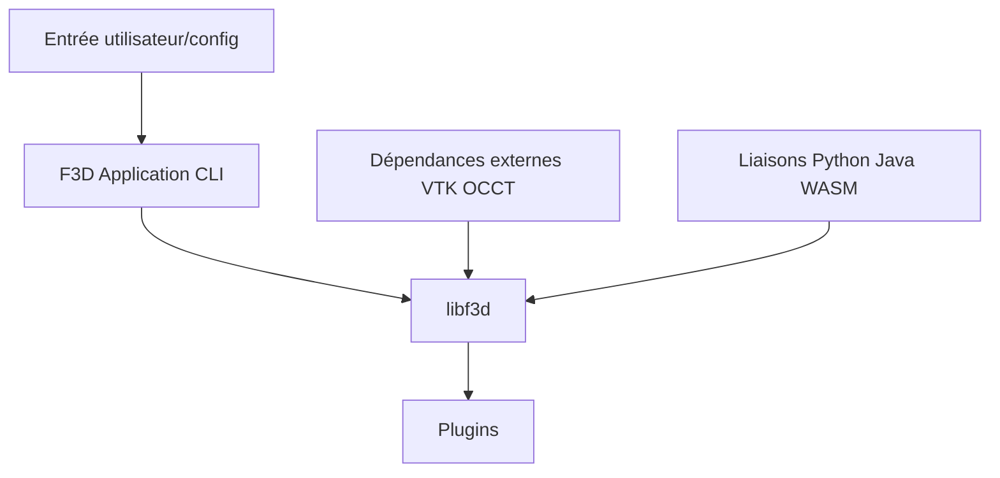

# f3d-app/f3d

> Minimalist command-line 3D viewer with the libf3d library, for anyone who needs to look at models quickly.

## The problem
Opening a 3D file or a scientific dataset forces you to launch heavy software.

## What it actually does
F3D opens many formats (glTF, USD, STL, STEP, PLY, OBJ, FBX, Alembic), displays animations and renders, generates thumbnails and can render to an image. Everything is driven from the command line or a configuration file. libf3d, in C++17, has C, Python, Java and JavaScript bindings. Formats are handled through plugins.

## How it is wired


## Trying it
```bash
f3d /path/to/file.ext
f3d /path/to/file.ext --output=/path/to/img.png
```

## Cost and gotchas
Free, binaries to download from the download page. Building it yourself requires the dependencies (VTK, etc.).

## What it is not
Not an editor: no menus or buttons, no export or data processing. It is not a modeling tool.

## Alternatives
No alternative named in the README.

## For you
Adopt it: handy for quickly inspecting scientific meshes or volumes, including in scripts to generate thumbnails.
