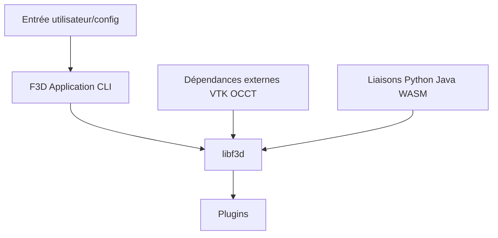

# f3d-app/f3d

> Visionneuse 3D minimaliste en ligne de commande, avec bibliothèque libf3d, pour qui doit regarder vite des modèles.

## Le problème
Ouvrir un fichier 3D ou un jeu de données scientifique oblige à lancer un logiciel lourd.

## Ce que ça fait vraiment
F3D ouvre de nombreux formats (glTF, USD, STL, STEP, PLY, OBJ, FBX, Alembic), affiche animations et rendus, génère des vignettes et peut rendre vers une image. Tout se pilote en ligne de commande ou fichier de configuration. libf3d, en C++17, a des liaisons C, Python, Java et JavaScript. Les formats passent par des greffons.

## Comment c'est branché


## Essayer
```bash
f3d /path/to/file.ext
f3d /path/to/file.ext --output=/path/to/img.png
```

## Coût et pièges
Gratuit, binaires à télécharger sur la page de téléchargement. Compiler soi-même demande les dépendances (VTK, etc.).

## Ce que ce n'est pas
Pas un éditeur : pas de menus ni de boutons, pas d'export ni de traitement de données. Ce n'est pas un outil de modélisation.

## Alternatives
Aucune alternative nommée dans le README.

## Pour toi
À adopter : pratique pour inspecter vite des maillages ou volumes scientifiques, y compris en script pour générer des vignettes.

