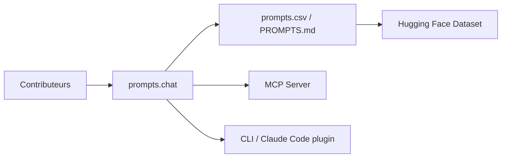

# f/awesome-chatgpt-prompts

> A collection of pre-written prompts (prompts.chat) for ChatGPT, Claude, Gemini, and other AI models, along with a guide and an MCP server.

## The problem
Find good starting prompts for common roles and tasks.

## What it actually does
Collection of prompts, accessible on prompts.chat in CSV, Markdown, and on a Hugging Face dataset. The project includes an interactive prompt engineering book (25 chapters), a game for children, a command-line interface, a Claude Code plugin, and an MCP server. Self-hosting is possible with PostgreSQL.

## How it is wired


## Trying it
```bash
npx prompts.chat
npx prompts.chat new my-prompt-library
```

## Cost and gotchas
Free. Self-hosting requires a PostgreSQL database and a configuration assistant. The popularity figures for the README are not verified.

## What it is not
This is not a catalog of evaluated prompts or an optimization tool. The architecture provided (Jekyll) is outdated compared to the current website.

## Alternatives
- No alternative is specified in the README.

## For you
Things to watch out for: occasional bursts of inspiration; for serious work, measure your prompts against your own specific cases rather than relying on a pre-defined list.
