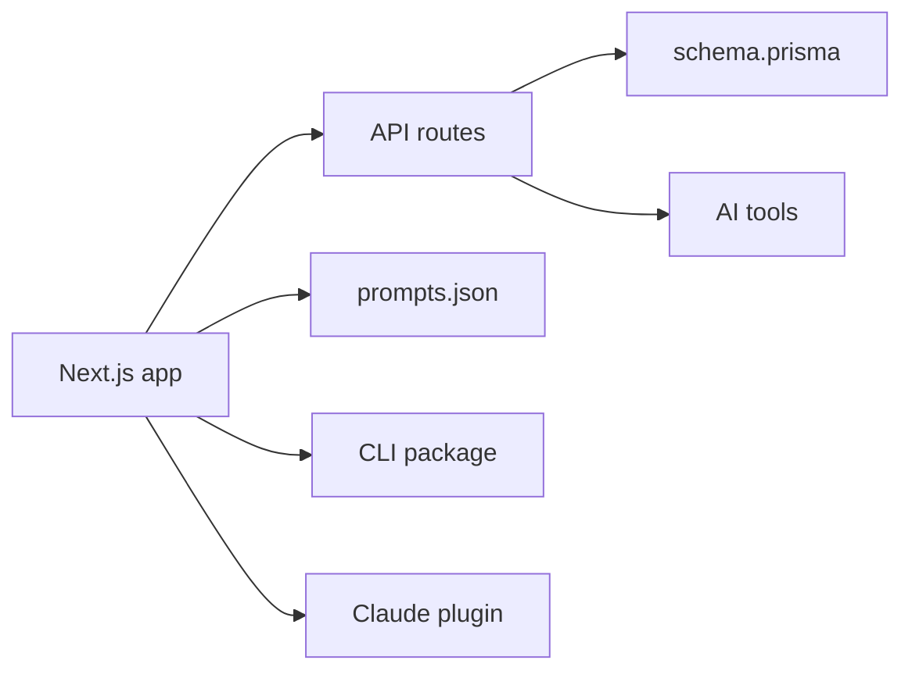

# f/prompts.chat

> A collection of prompts for chat models, self-hosted, with CLI, MCP server, and Claude Code plugin.

## The problem
Good prompts get lost in scattered notes, without any organization, versions, or sharing.

## What it actually does
A Next.js application serves the library: prompts, categories, comments, votes, CSV and JSON exports. Prisma and PostgreSQL store everything. AI routes (prompt improvement, translation, search by embeddings) are also included. Outside the website: an npm package with a CLI, a Raycast extension, a Claude Code plugin, and an MCP server. Two sub-sites: a prompting guide and a children's learning path.

## How it is wired


## Trying it
```bash
npx prompts.chat new my-prompt-library
git clone https://github.com/f/prompts.chat.git
cd prompts.chat
npm install && npm run setup
npx prompts.chat
/plugin marketplace add f/prompts.chat
```

## Cost and gotchas
PostgreSQL is required (Neon is recommended). Authentication with GitHub, Google, or Azure AD is configured during installation. AI functions require third-party keys.

## What it is not
This is not a prompt evaluation tool; it is a catalog. The citation and popularity figures for the README are those provided by the author.

## Alternatives
No alternative is specified in the README.

## For you
Things to watch out for: The "prompt game" and the MCP server are used to generate ideas, but the license must be checked before using them internally.
