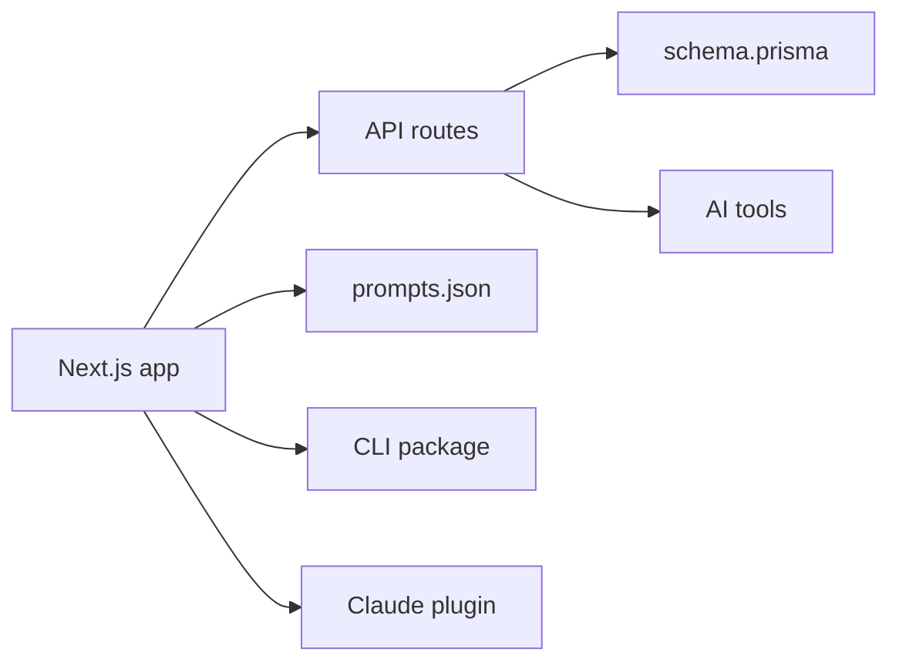

# f/prompts.chat

> Bibliothèque ouverte de prompts pour modèles de chat, auto-hébergeable, avec CLI, serveur MCP et plugin Claude Code.

## Le problème
Les bons prompts se perdent dans des notes dispersées, sans classement, versions ni partage.

## Ce que ça fait vraiment
Une application Next.js sert la bibliothèque : prompts, catégories, commentaires, votes, exports CSV et JSON. Prisma et PostgreSQL stockent tout. Des routes IA (amélioration de prompt, traduction, recherche par embeddings) s'ajoutent. Hors du site : un paquet npm avec CLI, une extension Raycast, un plugin Claude Code et un serveur MCP. Deux sous-sites : livre de prompting et parcours pour enfants.

## Comment c'est branché


## Essayer
```bash
npx prompts.chat new my-prompt-library
git clone https://github.com/f/prompts.chat.git
cd prompts.chat
npm install && npm run setup
npx prompts.chat
/plugin marketplace add f/prompts.chat
```

## Coût et pièges
PostgreSQL requis (Neon recommandé). L'authentification GitHub, Google ou Azure AD se configure à l'installation. Les fonctions IA demandent des clés tierces.

## Ce que ce n'est pas
Pas un outil d'évaluation de prompts : c'est un catalogue. Les chiffres de citations et de popularité du README sont ceux de l'auteur.

## Alternatives
Aucune alternative nommée dans le README.

## Pour toi
À surveiller : le jeu de prompts et le serveur MCP servent à piocher des idées, mais la licence est à vérifier avant d'en faire une brique interne.

