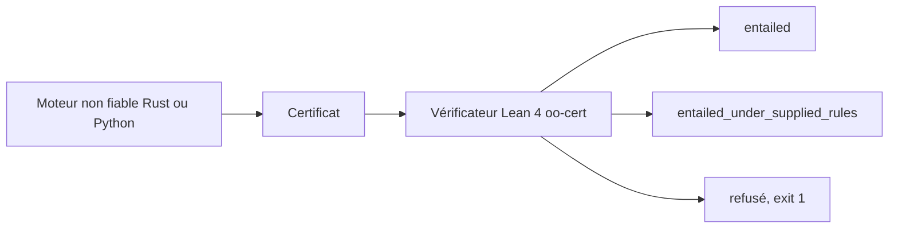

# fabio-rovai/open-ontologies

> Rust engine that plans an ontology change, shows its consequences and provides verifiable proof.

## The problem
A text diff of an ontology does not show what the change implies. A single correct line can create hundreds of new consequences.

## What it actually does
The tool reasons over OWL and RDFS, validates with SHACL, tests satisfiability and manages a plan, apply, drift, rollback cycle. Each reasoning run can produce a derivation certificate that checkers written in Lean 4 verify without the engine. A forged certificate is rejected with the line number and the rule. It speaks MCP to Claude or Cursor.

## How it is wired


## Trying it
```bash
open-ontologies --data-dir /tmp/oo-demo/store load coffee.ttl
open-ontologies --data-dir /tmp/oo-demo/store reason --profile rdfs --certificate ./cert
lake exe oo-cert /tmp/oo-demo/cert/asserted.tsv /tmp/oo-demo/cert/derivations.tsv
```

## Cost and gotchas
Free binary; the checker requires a Lean build. Storage is in memory by default, so a `reason` after `load` may certify nothing. Without `--data-dir`, writes go to `~/.open-ontologies`.

## What it is not
It is not an ontology editor (Protégé remains the tool for that). The README states that no guarantee covers unsatisfiability answers, and that two engines are not independent. A hosted offering exists separately (tesseractsemantics.com).

## Alternatives
Protégé for drawing hierarchies, HermiT as a comparison reasoner, both cited in the README.

## For you
Keep an eye on it: a useful niche if you manage ontologies or knowledge-graph RAG, but a young tool from a single author.
