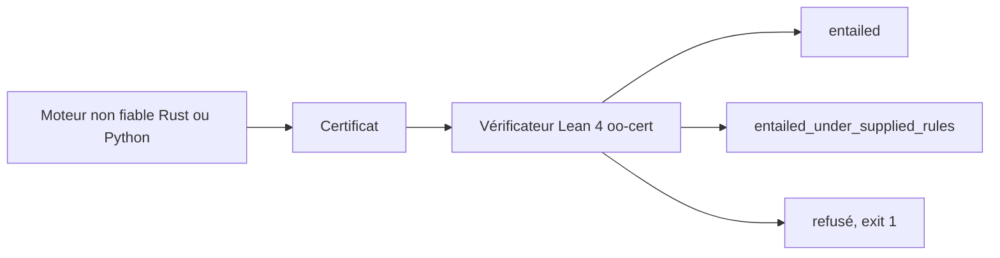

# fabio-rovai/open-ontologies

> Moteur Rust qui planifie un changement d'ontologie, en montre les conséquences et fournit une preuve vérifiable.

## Le problème
Un diff texte d'une ontologie ne montre pas ce que le changement implique. Une ligne correcte peut créer des centaines de conséquences nouvelles.

## Ce que ça fait vraiment
L'outil raisonne sur OWL et RDFS, valide en SHACL, teste la satisfiabilité et gère un cycle plan, application, dérive, retour arrière. Chaque raisonnement peut produire un certificat de dérivation que des vérificateurs écrits en Lean 4 contrôlent sans le moteur. Un certificat falsifié est refusé avec le numéro de ligne et la règle. Il parle MCP à Claude ou Cursor.

## Comment c'est branché


## Essayer
```bash
open-ontologies --data-dir /tmp/oo-demo/store load coffee.ttl
open-ontologies --data-dir /tmp/oo-demo/store reason --profile rdfs --certificate ./cert
lake exe oo-cert /tmp/oo-demo/cert/asserted.tsv /tmp/oo-demo/cert/derivations.tsv
```

## Coût et pièges
Binaire gratuit ; le vérificateur demande une compilation Lean. Le stockage est en mémoire par défaut, donc un `reason` après `load` peut ne rien certifier. Sans `--data-dir`, l'écriture va dans `~/.open-ontologies`.

## Ce que ce n'est pas
Ce n'est pas un éditeur d'ontologies (Protégé reste pour cela). Le README précise qu'aucune garantie ne couvre les réponses d'insatisfiabilité, et que deux moteurs ne sont pas indépendants. Une offre hébergée existe à part (tesseractsemantics.com).

## Alternatives
Protégé pour dessiner les hiérarchies, HermiT comme raisonneur de comparaison, tous deux cités dans le README.

## Pour toi
À surveiller : niche utile si tu gères des ontologies ou du RAG sur graphe de connaissances, mais outil jeune d'un seul auteur.

