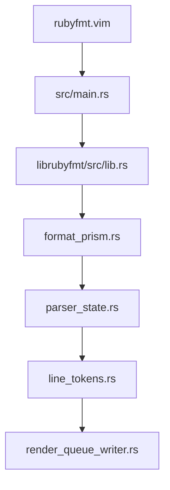

# fables-tales/rubyfmt

> Fast, opinionated Ruby code formatter, written in Rust, for Ruby teams.

## The problem
Ruby style debates slow down code reviews.

## What it actually does
The binary (src/main.rs) calls librubyfmt, which parses the Ruby with format_prism.rs, accumulates line tokens (parser_state.rs, line_tokens.rs) then produces the text via render_queue_writer.rs. File headers to enable or ignore, a .rubyfmtignore file, integrations with VS Code, Vim, Neovim, RubyMine, Sublime, Atom and Rubocop.

## How it is wired


## Trying it
```bash
brew install rubyfmt
rubyfmt -i myfile.rb
rubyfmt myfile.rb
cargo build --release
```

## Cost and gotchas
Free. The formatter is opinionated: few settings. The original author no longer contributes; other contributors are taking over.

## What it is not
Not a linter: for that, the README points to rubocop-rubyfmt.

## Alternatives
Rubocop, which can be plugged into rubyfmt via the rubocop-rubyfmt gem: it checks style in addition to reformatting. The README names no other formatter.

## For you
Ignore: only useful if you write Ruby, outside your data and AI scope.
