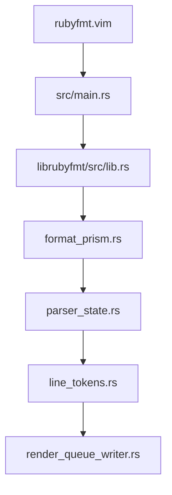

# fables-tales/rubyfmt

> Formateur de code Ruby rapide et opiniâtre, écrit en Rust, pour équipes Ruby.

## Le problème
Les débats de style Ruby ralentissent les revues de code.

## Ce que ça fait vraiment
Le binaire (src/main.rs) appelle librubyfmt, qui parse le Ruby avec format_prism.rs, accumule des jetons de ligne (parser_state.rs, line_tokens.rs) puis produit le texte via render_queue_writer.rs. En-têtes de fichier pour activer ou ignorer, fichier .rubyfmtignore, intégrations VS Code, Vim, Neovim, RubyMine, Sublime, Atom et Rubocop.

## Comment c'est branché


## Essayer
```bash
brew install rubyfmt
rubyfmt -i myfile.rb
rubyfmt myfile.rb
cargo build --release
```

## Coût et pièges
Gratuit. Le formateur est opiniâtre : peu de réglages. L'auteur d'origine ne contribue plus ; d'autres contributeurs prennent le relais.

## Ce que ce n'est pas
Pas un linter : pour cela, le README renvoie à rubocop-rubyfmt.

## Alternatives
Rubocop, qu'on peut brancher sur rubyfmt via la gem rubocop-rubyfmt : il vérifie le style en plus de reformater. Le README ne nomme pas d'autre formateur.

## Pour toi
À ignorer : utile uniquement si tu écris du Ruby, hors de ton périmètre data et IA.

