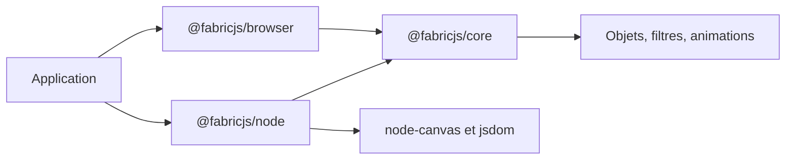

# fabricjs/fabric.js

> JavaScript library for manipulating an HTML5 canvas: shapes, text, images, interactions and export.

## The problem
The raw canvas API handles neither selectable objects, nor interactive transformations, nor SVG or JSON import/export.

## What it actually does
Object model on top of the canvas: move, resize, rotate, group, shapes, controls, animations, image filters, gradients, brushes, with import and export to JPG, PNG, JSON and SVG. The code is typed and modular. Since v6, the packages @fabricjs/browser, @fabricjs/node and @fabricjs/core separate the environments; "fabric" remains a compatibility facade. No readable component in the provided graph: what follows comes from the README.

## How it is wired


## Trying it
```bash
npm install @fabricjs/browser
npm install @fabricjs/node
npm install fabric --save
```

## Cost and gotchas
Free. On the Node side: node-canvas, with its limitations and bugs, and Node 20 minimum. The versions of "fabric" and of all the @fabricjs/* packages must match, otherwise several runtimes get loaded.

## What it is not
Not a 3D or WebGL engine. The README notes that @fabricjs/core is not DOM-independent.

## Alternatives
- Konva: similar features.
- PixiJS: WebGL rendering.
- Three.js: 3D graphics.

## For you
Watch: useful for generating or annotating images server-side or in a labeling interface, with no direct link to the data/AI core.
