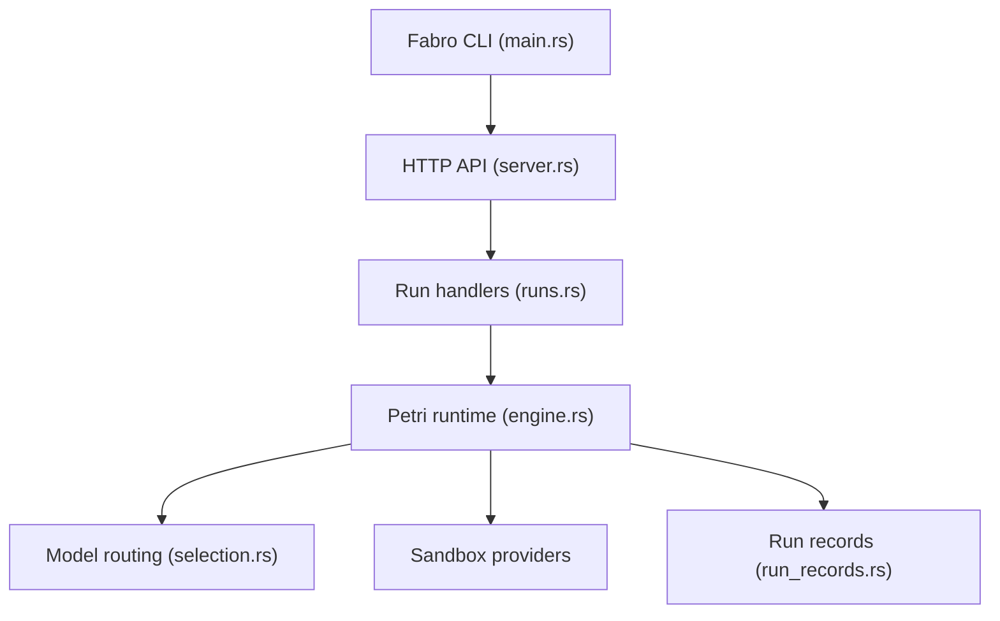

# fabro-sh/fabro

> Orchestrator for coding-agent workflows, defined as DOT graphs, for engineers who want to stay in control.

## The problem
A lone coding agent forces you to watch it at every step or to review a huge diff without trust.

## What it actually does
You describe the process in a Graphviz DOT graph, with branches, loops, parallelism and human approval gates. A routing stylesheet picks the model per node (a cheap model to plan, a stronger model to code). Each step commits to Git branches, and execution can run in Daytona cloud sandboxes. An API server and a web interface let you follow the runs.

## How it is wired


## Trying it
```bash
brew install fabro-sh/tap/fabro-nightly
curl -fsSL https://fabro.sh/install.sh | bash
fabro server start
cd my-project
fabro repo init
```

## Cost and gotchas
Single Rust binary, but model calls are at your expense (provider keys) and cloud sandboxes have their own bill. The recommended installation goes through `curl | bash`.

## What it is not
It is not an agent: it is the conductor that drives them. The repository has 130 open issues and dates from March 2026.

## Alternatives
No alternative named in the README.

## For you
Worth watching: the idea of versioned workflows with human gates speaks to MLOps teams, but the project is young.
