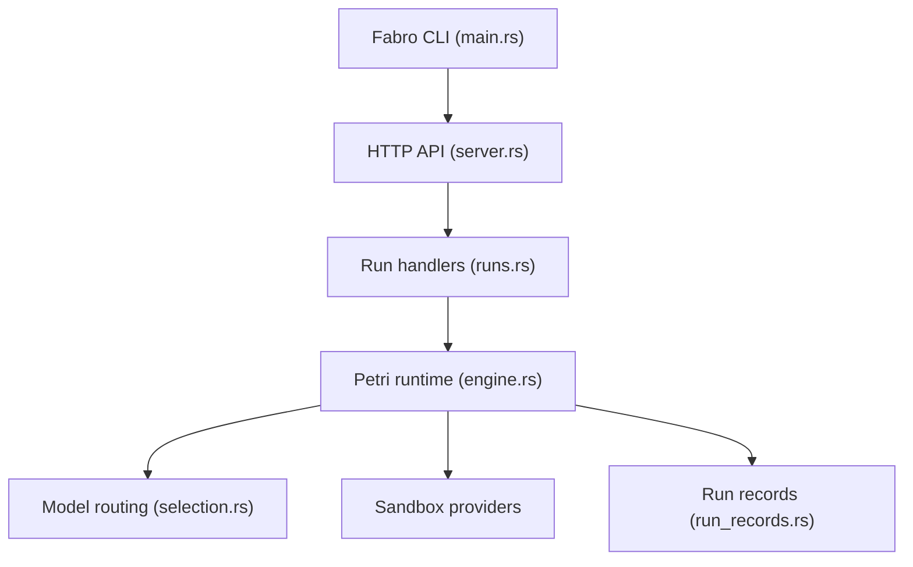

# fabro-sh/fabro

> Orchestrateur de workflows d'agents de code, définis en graphes DOT, pour ingénieurs qui veulent garder la main.

## Le problème
Un agent de code seul oblige à le surveiller à chaque pas ou à relire un énorme diff sans confiance.

## Ce que ça fait vraiment
On décrit le processus dans un graphe Graphviz DOT, avec branches, boucles, parallélisme et portes d'approbation humaine. Une feuille de style routage choisit le modèle par nœud (modèle bon marché pour planifier, modèle plus fort pour coder). Chaque étape commit sur des branches Git, et l'exécution peut tourner dans des bacs à sable cloud Daytona. Un serveur API et une interface web permettent de suivre les runs.

## Comment c'est branché


## Essayer
```bash
brew install fabro-sh/tap/fabro-nightly
curl -fsSL https://fabro.sh/install.sh | bash
fabro server start
cd my-project
fabro repo init
```

## Coût et pièges
Binaire Rust unique, mais les appels aux modèles sont à ta charge (clés des fournisseurs) et les bacs à sable cloud ont leur propre facture. L'installation recommandée passe par `curl | bash`.

## Ce que ce n'est pas
Ce n'est pas un agent : c'est le chef d'orchestre qui en pilote. Le dépôt a 130 issues ouvertes et date de mars 2026.

## Alternatives
Aucune alternative nommée dans le README.

## Pour toi
À surveiller : l'idée de workflows versionnés avec portes humaines parle aux équipes MLOps, mais le projet est jeune.

