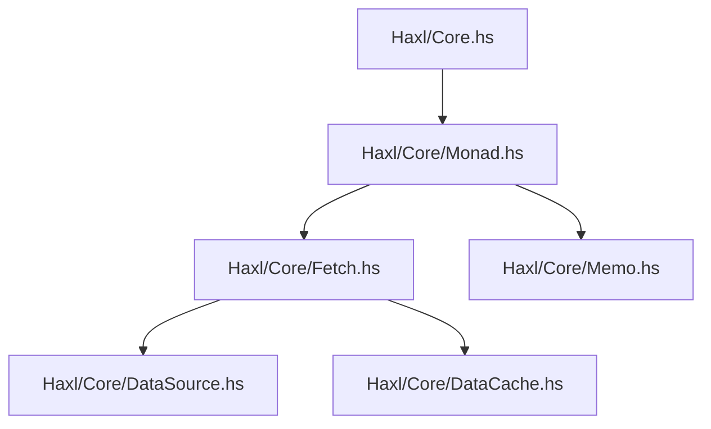

# facebook/Haxl

> Haskell library that batches and runs remote data accesses in parallel.

## The problem
Clean data-fetching code makes requests one by one; optimizing it makes it unreadable.

## What it actually does
The Haxl monad collects independent requests, groups them by data source, sends them concurrently, caches the results and memoizes computations. You write one data source per system (database, API). A generic ConcurrentIO source exists, as well as an incomplete Facebook Graph example. The README also mentions the N+1 problem of SQL queries.

## How it is wired

## Trying it
No command documented in the README; see the documentation on Hackage.

## Cost and gotchas
Free. You need Haskell (not listed in the standard prerequisites) and must write your own data sources.

## What it is not
Not a database client nor an ORM. The haxl-facebook package is only an incomplete example.

## Alternatives
No alternative named in the README.

## For you
Ignore: reserved for Haskell; only the idea of automatic request batching is worth keeping.
