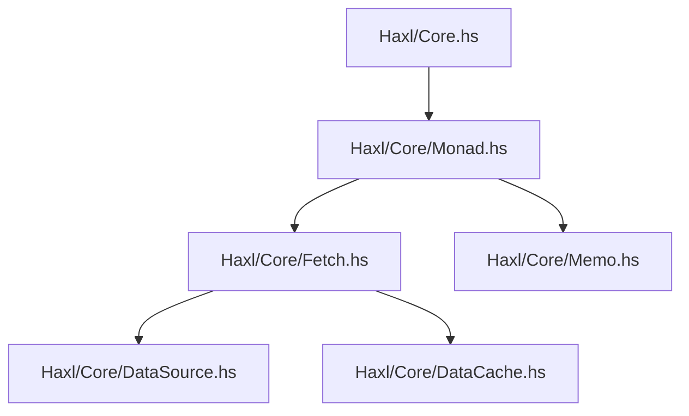

# facebook/Haxl

> Bibliothèque Haskell qui regroupe et exécute en parallèle les accès à des données distantes.

## Le problème
Du code de récupération de données propre fait des requêtes une par une ; l'optimiser le rend illisible.

## Ce que ça fait vraiment
La monade Haxl collecte les requêtes indépendantes, les regroupe par source de données, les envoie en concurrence, met en cache les résultats et mémoïse les calculs. On écrit une source de données par système (base, API). Une source générique ConcurrentIO existe, ainsi qu'un exemple Facebook Graph incomplet. Le README cite aussi le problème N+1 des requêtes SQL.

## Comment c'est branché

## Essayer
Aucune commande documentée dans le README ; voir la documentation sur Hackage.

## Coût et pièges
Gratuit. Il faut du Haskell (non listé dans les prérequis standard) et écrire ses propres sources de données.

## Ce que ce n'est pas
Pas un client de base de données ni un ORM. Le paquet haxl-facebook n'est qu'un exemple incomplet.

## Alternatives
Aucune alternative nommée dans le README.

## Pour toi
À ignorer : réservé à Haskell ; seule l'idée de regroupement automatique des requêtes vaut d'être retenue.

