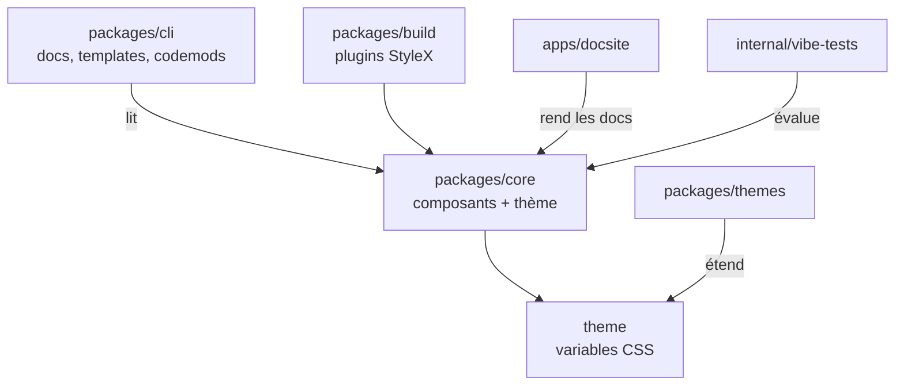

# facebook/astryx

> React/StyleX design system from Meta, 150+ components, designed for front-end teams and their AI assistants.

## The problem
Building a consistent, accessible, themeable interface costs a lot in components to write. AI assistants, meanwhile, improvise UIs with no shared reference.

## What it actually does
Provides typed React 19 components, precompiled CSS (no build plugin on the consumer side) and seven themes via CSS variable overrides. A CLI gives docs, templates, scaffolding and codemods. `swizzle` ejects a component's source code into your project. Announced status: Beta; `vega` and `charts` are published only under the `@canary` tag.

## How it is wired


## Trying it
```bash
npm install @astryxdesign/core @astryxdesign/theme-neutral @stylexjs/stylex
npm install -D @astryxdesign/cli
npm i -g @astryxdesign/cli
npm run astryx -- component --list
```

## Cost and gotchas
Free (MIT). Requires React 19 or later as a peer dependency. Beta: the API may change; 522 open issues.

## What it is not
Not a data or AI tool: it is front-end UI. The chart components (`charts`, `vega`) have no stable release. The "made for agents" angle is a design argument, not an AI integration shipped in the README.

## Alternatives
No alternative named in the README.

## For you
Worth watching: useful only if you build dashboards or internal-tool front ends in React 19; otherwise nothing to take from it for a data/MLOps profile.
