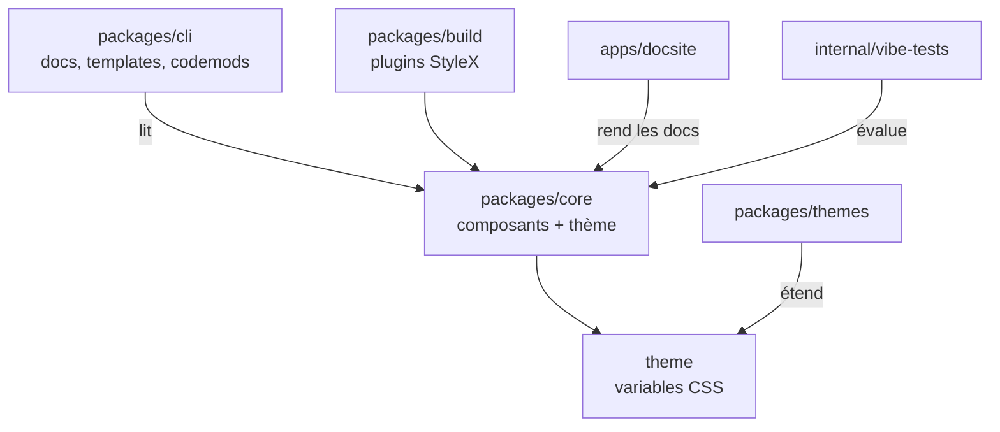

# facebook/astryx

> Design system React/StyleX issu de Meta, 150+ composants, pensé pour les équipes front et leurs assistants IA.

## Le problème
Monter une interface cohérente, accessible et thémable coûte cher en composants à écrire. Les assistants IA, eux, improvisent des UI sans référence commune.

## Ce que ça fait vraiment
Fournit des composants React 19 typés, du CSS précompilé (aucun plugin de build côté consommateur) et sept thèmes par surcharge de variables CSS. Un CLI donne docs, templates, scaffolding et codemods. `swizzle` éjecte le code source d'un composant dans ton projet. Statut annoncé : Beta ; `vega` et `charts` ne sont publiés que sous le tag `@canary`.

## Comment c'est branché


## Essayer
```bash
npm install @astryxdesign/core @astryxdesign/theme-neutral @stylexjs/stylex
npm install -D @astryxdesign/cli
npm i -g @astryxdesign/cli
npm run astryx -- component --list
```

## Coût et pièges
Gratuit (MIT). Exige React 19 ou plus en peer dependency. Beta : l'API peut bouger ; 522 issues ouvertes.

## Ce que ce n'est pas
Pas un outil data ni IA : c'est de l'UI front. Les composants de graphiques (`charts`, `vega`) n'ont pas de version stable. Le « fait pour les agents » est un argument de conception, pas une intégration IA livrée dans le README.

## Alternatives
Aucune alternative nommée dans le README.

## Pour toi
Surveiller : utile seulement si tu construis des dashboards ou des front d'outils internes en React 19 ; sinon rien à en tirer pour un profil data/MLOps.

