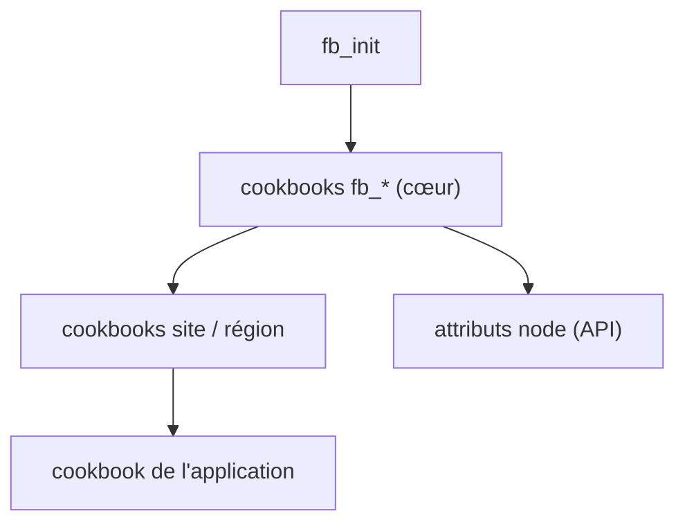

# facebook/chef-cookbooks

> Facebook's attribute-driven Chef cookbooks, for managing large server fleets.

## The problem
Community cookbooks rely on resources that fight over the same configuration, and settings that have disappeared are not removed.

## What it actually does
Provides `fb_*` cookbooks whose API is the `node` object: hashes and arrays close to the configured service, cascading from least specific to most specific in the run-list. Templates take control of entire files, so a removed setting disappears. The README also describes the style rules (`FB` module, fail when in doubt, `whyrun_safe_ruby_block`).

## How it is wired
Simplified diagram based on the sheet, no diagram provided.

## Trying it
The README asks you to rename `fb_init_sample` to `fb_init` and then follow its README; it gives no other command.

## Cost and gotchas
Free. Assumes Chef, a "run from main" mode and a testing tool such as Taste Tester; a model very different from common cookbooks.

## What it is not
It is not a kit to plug into any Chef infrastructure: you have to adopt Facebook's philosophy.

## Alternatives
No alternative named in the README (it cites Grocery Delivery, Taste Tester and Line Cook as associated tools).

## For you
Ignore: oriented toward server fleets under Chef, far from everyday data / AI work.
