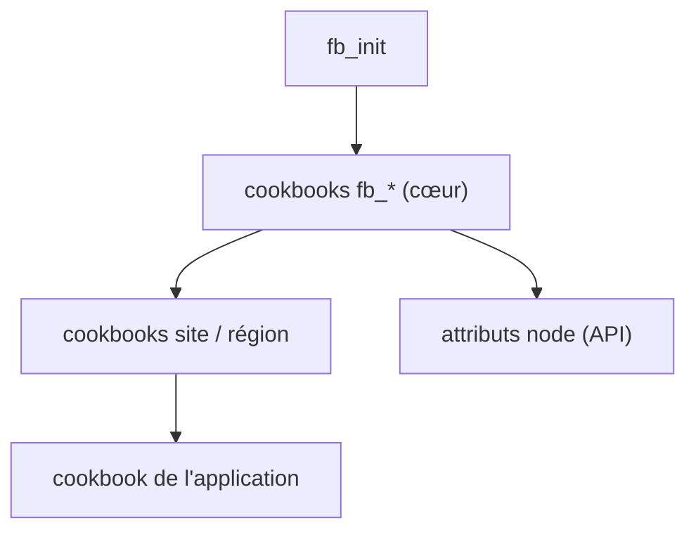

# facebook/chef-cookbooks

> Livres de recettes Chef de Facebook, pilotés par attributs, pour gérer de grandes flottes de serveurs.

## Le problème
Les cookbooks communautaires s'appuient sur des ressources qui se disputent la même configuration, et les réglages disparus ne sont pas retirés.

## Ce que ça fait vraiment
Fournit des cookbooks `fb_*` dont l'API est l'objet `node` : hashes et tableaux proches du service configuré, en cascade du moins spécifique au plus spécifique dans la run-list. Les gabarits prennent le contrôle de fichiers entiers, donc un réglage supprimé disparaît. Le README décrit aussi les règles de style (module `FB`, échec en cas de doute, `whyrun_safe_ruby_block`).

## Comment c'est branché
Schéma simplifié d'après la fiche, sans diagramme fourni.

## Essayer
Le README demande de renommer `fb_init_sample` en `fb_init` puis de suivre son README ; il ne donne pas d'autre commande.

## Coût et pièges
Gratuit. Suppose Chef, un mode « run from main » et un outil de test comme Taste Tester ; un modèle très différent des cookbooks courants.

## Ce que ce n'est pas
Ce n'est pas un kit à brancher dans n'importe quelle infra Chef : il faut adopter la philosophie de Facebook.

## Alternatives
Aucune alternative nommée dans le README (il cite Grocery Delivery, Taste Tester et Line Cook comme outils associés).

## Pour toi
À ignorer : orientée flottes de serveurs sous Chef, loin du travail data / IA courant.

