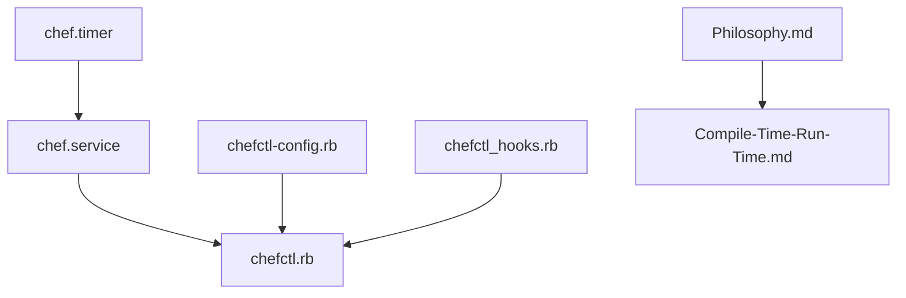

# facebook/chef-utils

> Chef utilities and documents published by Facebook, including the chefctl launcher.

## The problem
The README says nothing: it only announces "various Chef utilities and documents".

## What it actually does
According to the code: `chefctl` is a Chef launcher configured by `chefctl-config.rb` and extended by hooks, triggered by a systemd timer and its service. Two documents (`Philosophy.md`, `Compile-Time-Run-Time.md`) and a `chef-server-stats` script complete it. Details undocumented.

## How it is wired

## Trying it
No command documented.

## Cost and gotchas
Assumes a Chef and Ruby installation. Minimal README: little material to judge from.

## What it is not
Not a complete product: a collection of side tools.

## Alternatives
No alternative named in the README.

## For you
Ignore: Facebook's Chef tooling, unrelated to data/AI/MLOps.
