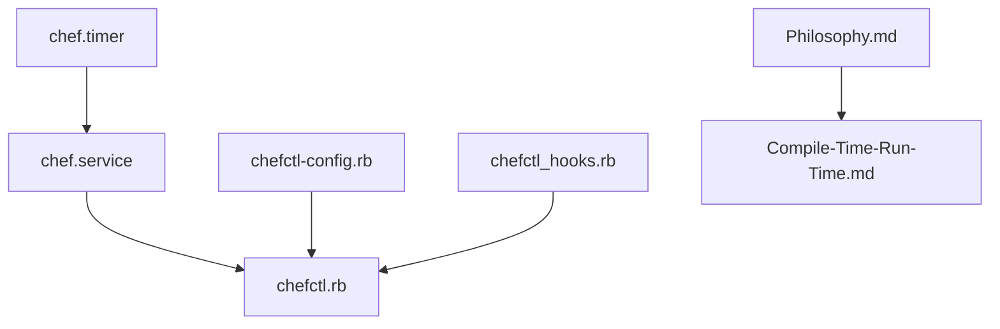

# facebook/chef-utils

> Utilitaires et documents Chef publiés par Facebook, dont le lanceur chefctl.

## Le problème
Le README ne dit rien : il annonce seulement « divers utilitaires et documents Chef ».

## Ce que ça fait vraiment
D'après le code : `chefctl` est un lanceur de Chef configuré par `chefctl-config.rb` et étendu par des hooks, déclenché par un timer systemd et son service. Deux documents (`Philosophy.md`, `Compile-Time-Run-Time.md`) et un script `chef-server-stats` complètent. Détails non documentés.

## Comment c'est branché

## Essayer
Aucune commande documentée.

## Coût et pièges
Suppose une installation Chef et Ruby. README minimal : peu de matière pour juger.

## Ce que ce n'est pas
Pas un produit complet : un recueil d'outils annexes.

## Alternatives
Aucune alternative nommée dans le README.

## Pour toi
Ignorer : outillage Chef de Facebook, sans lien avec data/IA/MLOps.

