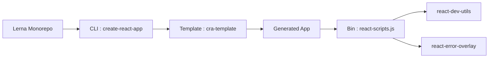

# facebook/create-react-app

> A single-page React project generator with a preconfigured build, for developers new to React.

## The problem
Configuring webpack, Babel and ESLint to start a React application is slow and fragile.

## What it actually does
README identical to that of react/create-react-app. The architecture graph describes a Lerna monorepo: the `create-react-app` CLI reads a template (`cra-template`, `cra-template-typescript`), generates the app, and `react-scripts` drives webpack, Babel and Jest through `start`, `build`, `test`, `eject`. The support packages (`react-dev-utils`, `react-error-overlay`, presets) sit alongside; Docusaurus and the test tasks make up the rest.

## How it is wired


## Trying it
```bash
npx create-react-app my-app
cd my-app
npm start
```

## Cost and gotchas
Free. Last push in February 2025 (over a year ago), 2,411 open issues. Apparently identical repository to react/create-react-app: do not count it twice when sorting.

## What it is not
Not a framework: it generates a project and hides the config. The README acknowledges that the tool imposes a specific way of working, and that ejecting forces you to maintain your own configuration.

## Alternatives
- Next.js: for server rendering and pre-rendering.
- Gatsby: for a mostly static site.
- Neutrino: for more customization.

## For you
Ignore: a front-end tool with no update for over a year, and outside the data/AI/MLOps scope.
