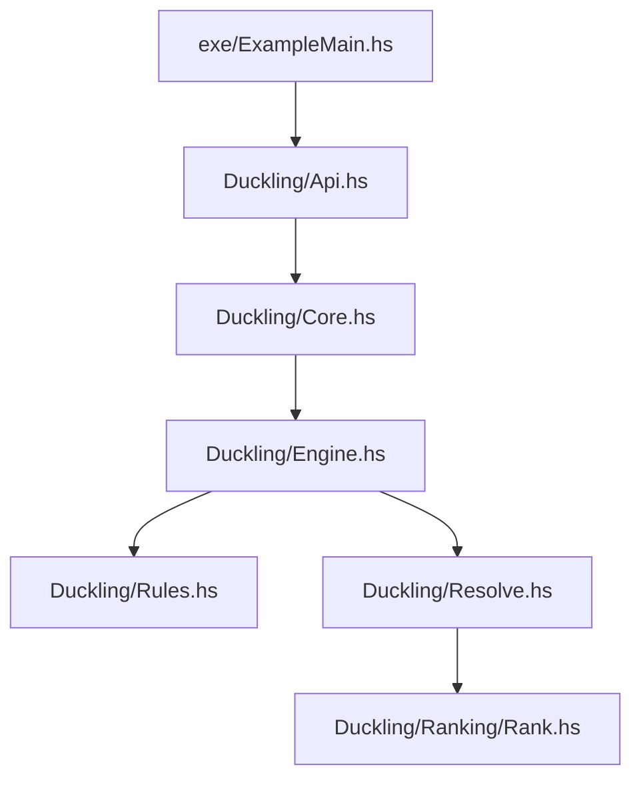

# facebook/duckling

> Haskell library that extracts dates, numbers, amounts and other structured entities from free text.

## The problem
Turning "the first Tuesday of October" or "tomorrow at eight" into usable values requires a reliable natural language parser.

## What it actually does
A rules engine (character or token pattern, production) produces tokens, resolved into entities and then ranked by classifiers generated per language. Dimensions: time, numeral, quantity, money, duration, email, URL, phone number, credit card. An example HTTP server exposes `/parse`. No database.

## How it is wired
Diagram based on the one provided.



## Trying it
```bash
stack build
stack exec duckling-example-exe
curl -XPOST http://0.0.0.0:8000/parse --data 'locale=en_GB&text=tomorrow at eight'
```

## Cost and gotchas
Free. You need a Haskell environment (stack) and the PCRE headers. The first run downloads all the packages. After changes, regenerate the classifiers.

## What it is not
Not a language model: a rule system to extend by hand for each language. The repository has had no commit since March 2026 but is not archived.

## Alternatives
- wit.ai: hosted built-in entities, if your backend is not in Haskell.

## For you
Worth watching: a good building block to extract dates and amounts in an NLP pipeline through its HTTP API, despite the cost of a Haskell build.
