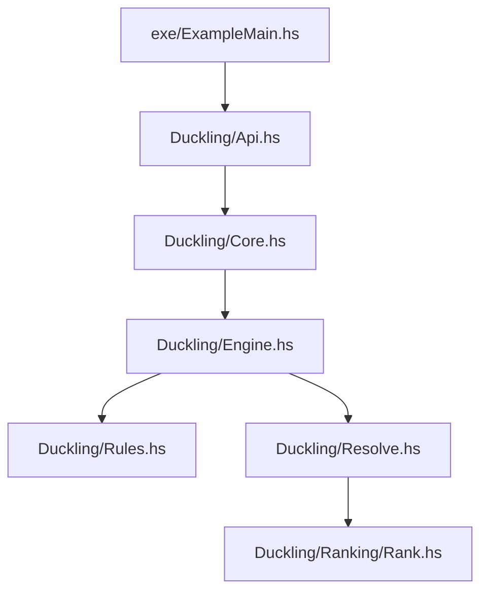

# facebook/duckling

> Bibliothèque Haskell qui extrait dates, nombres, montants et autres entités structurées de texte libre.

## Le problème
Transformer « the first Tuesday of October » ou « tomorrow at eight » en valeurs exploitables demande un analyseur de langage naturel fiable.

## Ce que ça fait vraiment
Un moteur de règles (motif de caractères ou de jetons, production) produit des jetons, résolus en entités puis classés par des classifieurs générés par langue. Dimensions : temps, numéral, quantité, argent, durée, e-mail, URL, téléphone, carte bancaire. Un serveur HTTP d'exemple expose `/parse`. Pas de base de données.

## Comment c'est branché
Schéma d'après le diagramme fourni.



## Essayer
```bash
stack build
stack exec duckling-example-exe
curl -XPOST http://0.0.0.0:8000/parse --data 'locale=en_GB&text=tomorrow at eight'
```

## Coût et pièges
Gratuit. Il faut un environnement Haskell (stack) et les en-têtes PCRE. Le premier lancement télécharge tous les paquets. Après modification, régénérer les classifieurs.

## Ce que ce n'est pas
Pas un modèle de langage : un système de règles à étendre à la main pour chaque langue. Le dépôt n'a pas de commit depuis mars 2026 mais n'est pas archivé.

## Alternatives
- wit.ai : entités intégrées hébergées, si ton backend n'est pas en Haskell.

## Pour toi
À surveiller : bonne brique pour extraire dates et montants dans un pipeline NLP via son API HTTP, malgré le coût d'un build Haskell.

