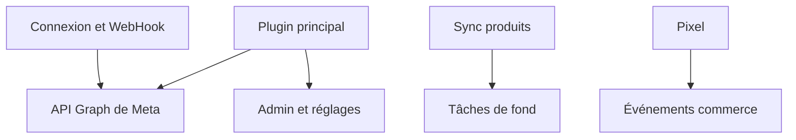

# facebook/facebook-for-woocommerce

> Meta WordPress extension that syncs the WooCommerce catalog with Facebook, Instagram and WhatsApp.

## The problem
A WooCommerce seller has to keep their advertising catalog and their conversion tracking up to date separately.

## What it actually does
The extension syncs eligible products with the Meta catalog, installs the conversion pixel, connects the account in one step and sends events, including those from physical stores. It includes a crash guard that pauses the extension after repeated crashes.

## How it is wired


## Trying it
```bash
npm install
composer install
npm start
npm run test:php
```

## Cost and gotchas
Free, but requires a Meta account and a WooCommerce store. Events are sent to Meta. PHPCS is not supported on PHP 8.1 and later.

## What it is not
Not a standalone marketing tool: everything depends on Meta's services. A development repository, not user support.

## Alternatives
No alternative named in the README.

## For you
Ignore: an online-store connector tied to Meta, unrelated to data, AI or MLOps work.
