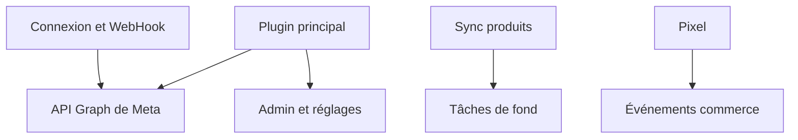

# facebook/facebook-for-woocommerce

> Extension WordPress de Meta qui synchronise le catalogue WooCommerce avec Facebook, Instagram et WhatsApp.

## Le problème
Un vendeur WooCommerce doit tenir à jour son catalogue publicitaire et ses suivis de conversion séparément.

## Ce que ça fait vraiment
L'extension synchronise les produits éligibles avec le catalogue Meta, installe le pixel de conversion, connecte le compte en une fois et envoie les événements, y compris ceux des magasins physiques. Elle comporte un garde contre les plantages qui met l'extension en pause après des plantages répétés.

## Comment c'est branché


## Essayer
```bash
npm install
composer install
npm start
npm run test:php
```

## Coût et pièges
Gratuit, mais exige un compte Meta et un WooCommerce. Les événements partent chez Meta. PHPCS n'est pas pris en charge sous PHP 8.1 et plus.

## Ce que ce n'est pas
Pas un outil de marketing autonome : tout dépend des services de Meta. Dépôt de développement, pas le support utilisateur.

## Alternatives
Aucune alternative nommée dans le README.

## Pour toi
À ignorer : un connecteur de boutique en ligne lié à Meta, sans lien avec un travail data, IA ou MLOps.

