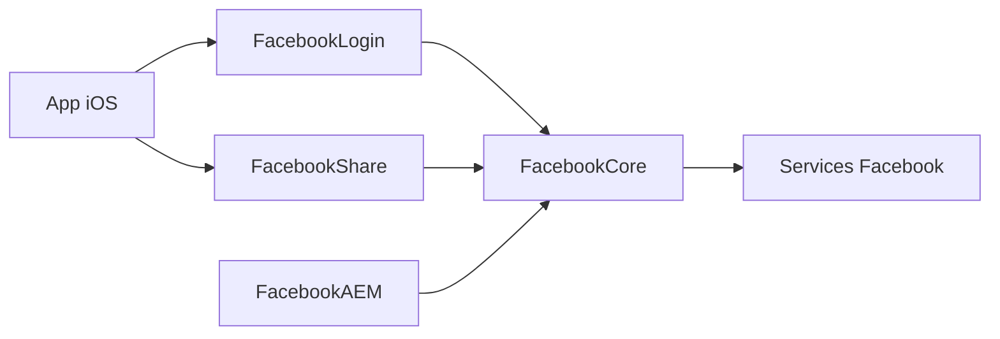

# facebook/facebook-ios-sdk

> Facebook SDK for iOS apps: login, sharing, App Links, Graph API and analytics.

## The problem
Integrating Facebook login, sharing and ad measurement by hand into an iOS app is long and fragile.

## What it actually does
Swift/Objective-C modules: FacebookCore, Login, Share, AEM, GamingServices. Installed via Swift Package Manager. It sends usage events to Facebook; the README reminds you of the disclosure (iOS 14) and consent obligations. A rewrite in Swift is under way, interfaces are unstable.

## How it is wired


## Trying it
```bash
# README : Xcode > File > Swift Packages > Add Package Dependency, puis l'URL du dépôt
```

## Cost and gotchas
Free, but usage data goes back to Facebook; you need a Facebook developer account, a privacy policy and the App Store declarations.

## What it is not
Not an AI or data tool. License not recognized by GitHub: read it before use.

## Alternatives
No alternative named in the README.

## For you
Ignore: mobile SDK tied to the Facebook ecosystem, of no interest for data/AI/MLOps.
