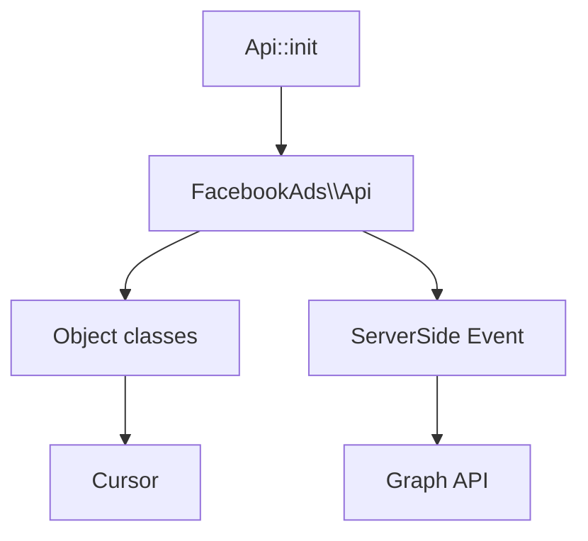

# facebook/facebook-php-business-sdk

> Meta's official PHP SDK for driving the Ads, Pages, Instagram and Conversions APIs from a server.

## The problem
Using several Meta APIs by hand is slow to integrate and to maintain.

## What it actually does
Provides object classes for the Graph API: read, create, update and delete (ad accounts, ad sets), cursors with pagination and a Conversions API client that sends events server-side. A Parameter Builder fills in and hashes user fields. The code is auto-generated.

## How it is wired
Simplified diagram based on the sheet, no diagram provided.


## Trying it
```bash
composer require facebook/php-business-sdk
./vendor/bin/phpunit -c test/phpunit-travis.xml
```

## Cost and gotchas
Free, but requires an app registered on developers.facebook.com and an access token. Integration tests require a real ad account. PHP 8.0 minimum.

## What it is not
Not an analysis tool: it calls Meta's APIs. GitHub issues are closed in favor of a dedicated channel.

## Alternatives
No alternative named in the README.

## For you
Ignore: a PHP integration tied to Meta advertising, of no interest for data / AI / MLOps work.
