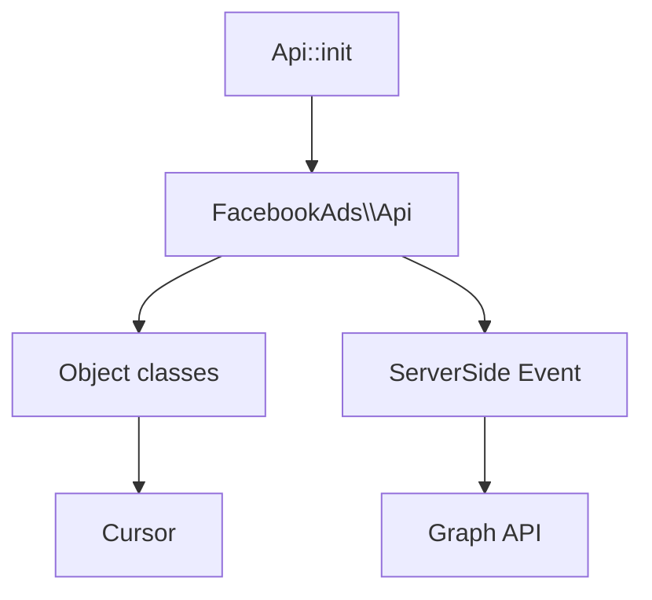

# facebook/facebook-php-business-sdk

> SDK PHP officiel de Meta pour piloter les API Ads, Pages, Instagram et Conversions depuis un serveur.

## Le problème
Utiliser plusieurs API Meta à la main est long à intégrer et à maintenir.

## Ce que ça fait vraiment
Fournit des classes objets pour le Graph API : lecture, création, mise à jour et suppression (comptes publicitaires, jeux d'annonces), curseurs avec pagination et un client Conversions API qui envoie des événements côté serveur. Un Parameter Builder remplit et hache des champs utilisateur. Le code est généré automatiquement.

## Comment c'est branché
Schéma simplifié d'après la fiche, sans diagramme fourni.


## Essayer
```bash
composer require facebook/php-business-sdk
./vendor/bin/phpunit -c test/phpunit-travis.xml
```

## Coût et pièges
Gratuit, mais exige une application enregistrée sur developers.facebook.com et un jeton d'accès. Les tests d'intégration demandent un compte publicitaire réel. PHP 8.0 minimum.

## Ce que ce n'est pas
Pas un outil d'analyse : il appelle les API de Meta. Les issues GitHub sont fermées au profit d'un canal dédié.

## Alternatives
Aucune alternative nommée dans le README.

## Pour toi
À ignorer : intégration PHP liée à la publicité Meta, sans intérêt pour un travail data / IA / MLOps.

