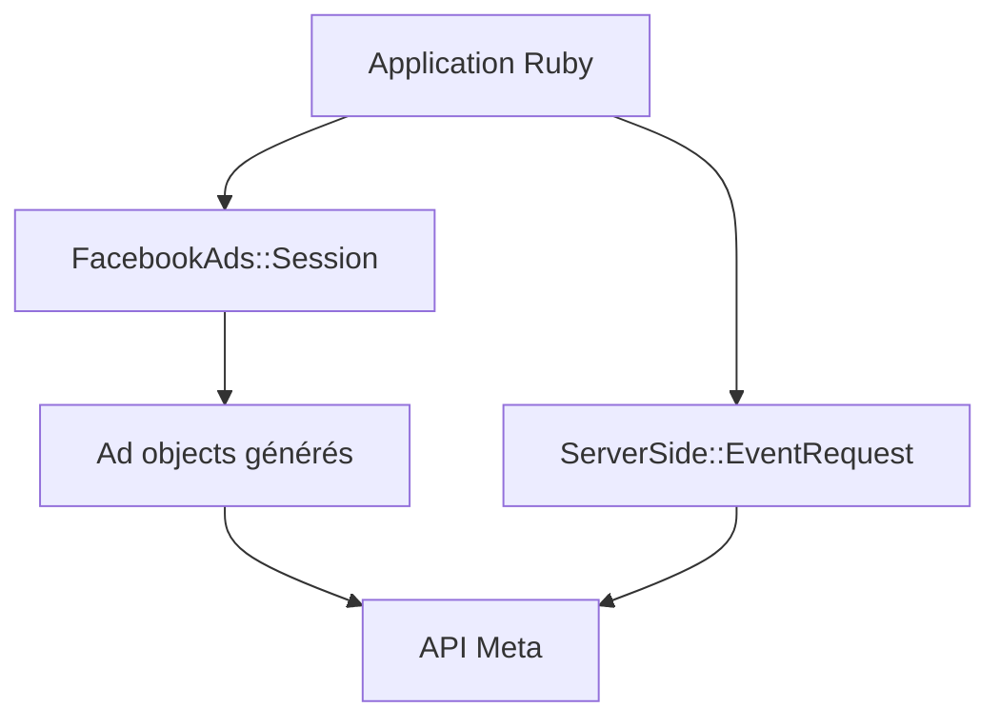

# facebook/facebook-ruby-business-sdk

> Official Ruby SDK for the Meta Business APIs: advertising, pages, Instagram, Conversions API.

## The problem
Managing Meta ad accounts and events from Ruby without writing the HTTP calls by hand.

## What it actually does
Classes generated from the API metadata (`AdAccount`, `Campaign`), reading, updating and deleting nodes, iterable edges, batch calls, and a server-side client for the Conversions API.

## How it is wired
Simplified diagram based on the sheet, no diagram provided.


## Trying it
```bash
gem install facebookbusiness
```

## Cost and gotchas
Free, but an access token and an application registered with Meta are required. Ruby 3.0 minimum.

## What it is not
Not standalone: it depends entirely on the Meta APIs.

## Alternatives
No alternative named in the README.

## For you
Ignore: Ruby advertising tool, outside the data/AI scope, and tied to the Meta platform.
