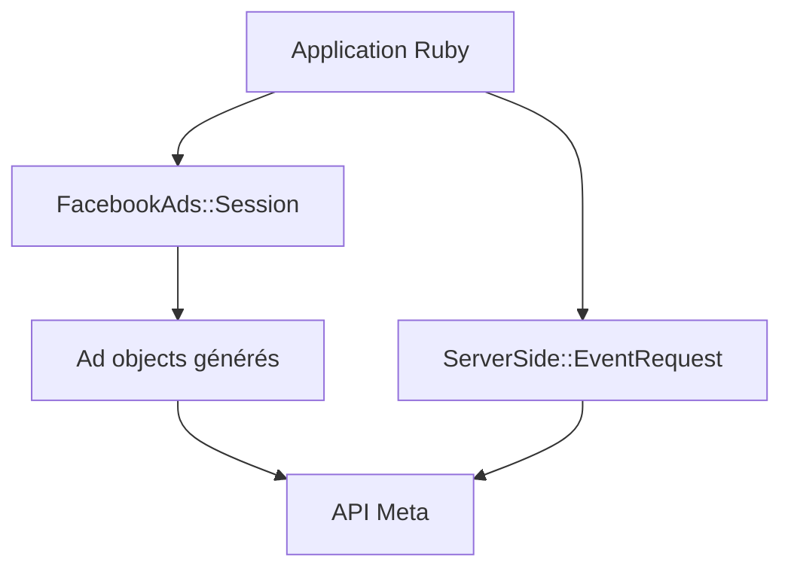

# facebook/facebook-ruby-business-sdk

> SDK Ruby officiel pour les API Meta Business : publicité, pages, Instagram, Conversions API.

## Le problème
Piloter comptes publicitaires et événements Meta depuis Ruby sans écrire les appels HTTP à la main.

## Ce que ça fait vraiment
Classes générées depuis les métadonnées de l'API (`AdAccount`, `Campaign`), lecture, mise à jour et suppression de nœuds, arêtes itérables, appels par lot, et client serveur pour la Conversions API.

## Comment c'est branché
Schéma simplifié d'après la fiche, sans diagramme fourni.


## Essayer
```bash
gem install facebookbusiness
```

## Coût et pièges
Gratuit, mais jeton d'accès et application enregistrée chez Meta requis. Ruby 3.0 minimum.

## Ce que ce n'est pas
Pas autonome : dépend entièrement des API Meta.

## Alternatives
Aucune alternative nommée dans le README.

## Pour toi
À ignorer : outil de publicité Ruby, hors périmètre data/IA, et lié à la plateforme Meta.

