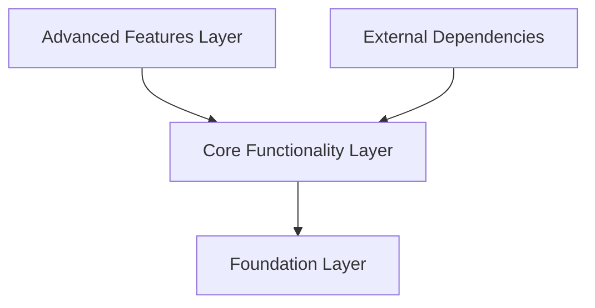

# facebook/folly

> C++20 library of Facebook components, a complement to Boost and the standard library.

## The problem
C++ components that perform well at scale and that neither `std` nor Boost provide, shared across Meta's open source projects.

## What it actually does
A collection of relatively independent components, all in the `folly` namespace: containers, synchronization, futures and executors, fibers, strings, I/O, logging, portability. Performance is the common thread, sometimes at the cost of unusual APIs. The `experimental` folder is discouraged for clients. Components are removed when `std` or Boost make them unnecessary. No ABI compatibility from one commit to the next.

## How it is wired


## Trying it
```bash
git clone https://github.com/facebook/folly
cd folly
cmake -B _build
cmake --build _build
```

## Cost and gotchas
Free. A C++20 compiler is required; the README recommends a static library, for lack of ABI stability. `cmake --install` requires CMake 3.28 or later. Many tests are disabled on Windows.

## What it is not
Not a stable library with frozen versions: it breaks from one commit to the next. It is only useful to C++ developers.

## Alternatives
- Boost and `std`: cited by the README as the references that folly complements.

## For you
Ignore: a C++ library internal to Meta, which you will only encounter as a dependency of C++ projects (such as PyTorch or others).
