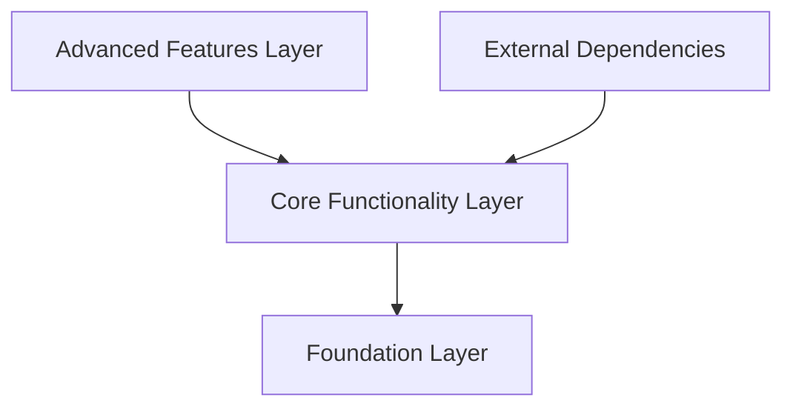

# facebook/folly

> Bibliothèque C++20 de composants de Facebook, complément de Boost et de la bibliothèque standard.

## Le problème
Des composants C++ performants à grande échelle que ni `std` ni Boost ne fournissent, partagés entre les projets open source de Meta.

## Ce que ça fait vraiment
Collection de composants relativement indépendants, tous dans l'espace de noms `folly` : conteneurs, synchronisation, futures et exécuteurs, fibres, chaînes, E/S, journalisation, portabilité. La performance sert de fil conducteur, parfois au prix d'API inhabituelles. Le dossier `experimental` est déconseillé aux clients. Les composants sont retirés quand `std` ou Boost les rendent inutiles. Aucune compatibilité ABI d'un commit à l'autre.

## Comment c'est branché


## Essayer
```bash
git clone https://github.com/facebook/folly
cd folly
cmake -B _build
cmake --build _build
```

## Coût et pièges
Gratuit. Compilateur C++20 requis ; le README conseille une bibliothèque statique, faute de stabilité ABI. `cmake --install` exige CMake 3.28 ou plus. Beaucoup de tests sont désactivés sous Windows.

## Ce que ce n'est pas
Pas une bibliothèque stable à version figée : elle se casse d'un commit à l'autre. Elle n'est utile qu'aux développeurs C++.

## Alternatives
- Boost et `std` : cités par le README comme les références que folly complète.

## Pour toi
À ignorer : bibliothèque C++ interne à Meta, que tu ne croiseras qu'en dépendance de projets C++ (comme PyTorch ou autres).

