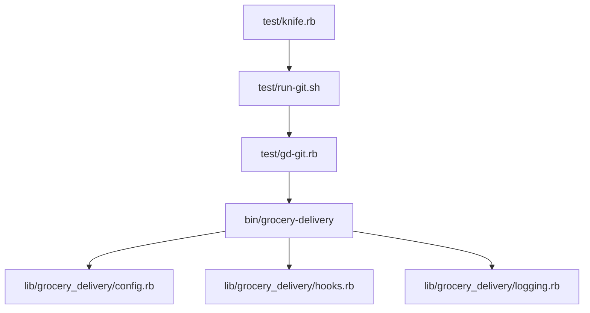

# facebook/grocery-delivery

> Ruby script that syncs cookbooks, roles and databags from a VCS repository to a Chef server.

## The problem
Several Chef servers that must stay identical drift apart if cookbooks are uploaded by hand.

## What it actually does
Reads its Mixlib configuration then syncs cookbooks, roles and databags from the repository to the Chef server, with a lock so it can run every minute from cron. Any commit on HEAD is uploaded immediately. Ruby plugin with hooks (preflight_checks, prerun, postrun, atexit).

## How it is wired

## Trying it
Configuration through `/etc/gd-config.rb` (or the `-c` option); options such as `-n` for a dry run. No install command in the README.

## Cost and gotchas
Assumes a Chef server, Knife, and a model without versions or environments. Depends on Mixlib::Config and BetweenMeals.

## What it is not
Not a full configuration management tool: it assumes Chef and a workflow where commits go to production immediately.

## Alternatives
Berkshelf: built-in option to resolve dependencies.

## For you
Ignore: Chef tool, no direct link to modern data/AI/MLOps.
