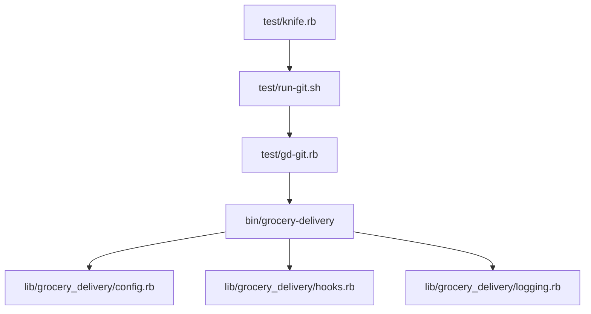

# facebook/grocery-delivery

> Script Ruby qui synchronise cookbooks, rôles et databags d'un dépôt VCS vers un serveur Chef.

## Le problème
Plusieurs serveurs Chef qui doivent rester identiques dérivent si l'on charge les cookbooks à la main.

## Ce que ça fait vraiment
Lit sa configuration Mixlib puis synchronise cookbooks, rôles et databags du dépôt vers le serveur Chef, avec verrou pour tourner chaque minute en cron. Tout commit sur HEAD est téléversé immédiatement. Plugin Ruby avec hooks (preflight_checks, prerun, postrun, atexit).

## Comment c'est branché

## Essayer
Configuration par `/etc/gd-config.rb` (ou option `-c`) ; options comme `-n` pour un essai à blanc. Pas de commande d'installation dans le README.

## Coût et pièges
Suppose un serveur Chef, Knife, et un modèle sans versions ni environnements. Dépendances Mixlib::Config et BetweenMeals.

## Ce que ce n'est pas
Pas un outil de gestion de configuration complet : il suppose Chef et un flux où les commits sont immédiatement en production.

## Alternatives
Berkshelf : option intégrée pour résoudre les dépendances.

## Pour toi
À ignorer : outil Chef, sans lien direct avec data/IA/MLOps moderne.

