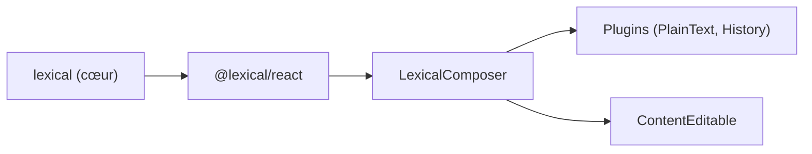

# facebook/lexical

> Extensible text editor framework for the web, with official React bindings.

## The problem
Building an accessible, reliable rich text editor in a web application takes a long time.

## What it actually does
A framework-independent core, with plugins, an immutable state with undo and redo, collaborative editing through Yjs, and import and export in JSON, Markdown and HTML. Handles tables, lists, code blocks and images. Written in TypeScript.

## How it is wired

Simplified diagram based on the sheet, no diagram provided.

## Trying it
```bash
npm install lexical @lexical/react
pnpm install
pnpm run start
pnpm run test-unit
```

## Cost and gotchas
Free, MIT license. Supported browsers: Firefox 115+, Safari 15+, Chrome 86+. Development of the repo uses pnpm.

## What it is not
Not a ready-to-use editor: it is a building framework. Not related to notebooks or data tools.

## Alternatives
No alternative named in the README.

## For you
Ignore: useful only if you are building a web text-editing interface, outside the usual data, AI or MLOps scope.
