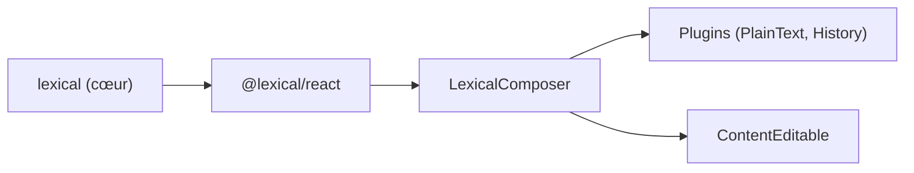

# facebook/lexical

> Framework d'éditeur de texte extensible pour le web, avec liaisons React officielles.

## Le problème
Construire un éditeur de texte riche accessible et fiable dans une application web est long.

## Ce que ça fait vraiment
Un cœur indépendant de tout framework, avec des plugins, un état immuable avec annulation et rétablissement, l'édition collaborative via Yjs et l'import et l'export en JSON, Markdown et HTML. Gère tables, listes, blocs de code et images. Écrit en TypeScript.

## Comment c'est branché

Schéma simplifié d'après la fiche, sans diagramme fourni.

## Essayer
```bash
npm install lexical @lexical/react
pnpm install
pnpm run start
pnpm run test-unit
```

## Coût et pièges
Gratuit, licence MIT. Navigateurs pris en charge : Firefox 115+, Safari 15+, Chrome 86+. Le développement du dépôt utilise pnpm.

## Ce que ce n'est pas
Pas un éditeur prêt à l'emploi : c'est un cadre de construction. Pas lié aux notebooks ni aux outils data.

## Alternatives
Aucune alternative nommée dans le README.

## Pour toi
À ignorer : utile seulement si tu construis une interface web d'édition de texte, hors du périmètre data, IA ou MLOps courant.

