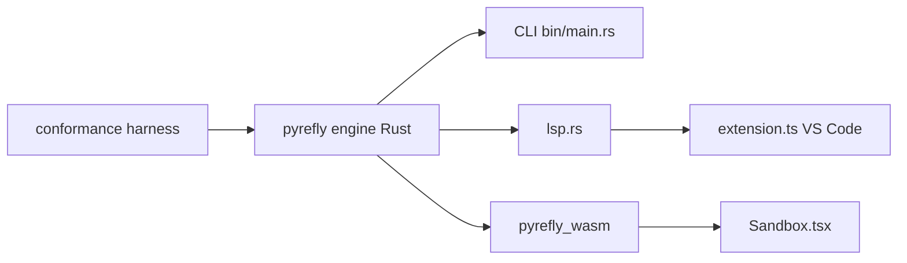

# facebook/pyrefly

> Python type checker and language server in Rust, for teams that type large codebases.

## The problem
Mypy and Pyright become slow on large Python codebases, and the IDE is slow to react.

## What it actually does
Checks types on the command line and provides navigation, completion, hover and highlighting in the editor (VS Code, Neovim, Zed). Handles Pydantic, Django and pytest. `pyrefly init` migrates from Mypy or Pyright, `suppress` hides existing errors, `infer` adds annotations. According to the README: more than 1.85 million lines per second and 15 times faster than Mypy and Pyright on PyTorch.

## How it is wired


## Trying it
```bash
pip install pyrefly
pyrefly init
pyrefly suppress
pyrefly infer
```

## Cost and gotchas
Free. Monthly minor versions, without strict semver: any version may add type errors, hence `pyrefly suppress` at each upgrade.

## What it is not
Not a guaranteed replacement for Mypy: results may differ and each version may break CI. 737 open issues.

## Alternatives
Mypy and Pyright (compared on speed in the README).

## For you
Adopt: clear speed gain on large ML repos, backed by Meta and adopted by PyTorch and JAX according to the README.
