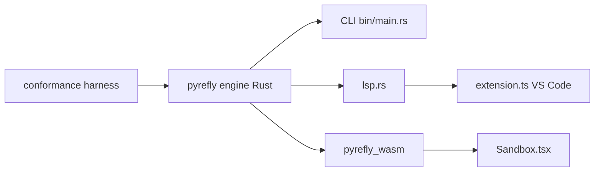

# facebook/pyrefly

> Vérificateur de types et serveur de langage Python en Rust, pour équipes qui typent de gros codes.

## Le problème
Mypy et Pyright deviennent lents sur de grandes bases Python, et l'IDE tarde à réagir.

## Ce que ça fait vraiment
Vérifie les types en ligne de commande et fournit navigation, complétion, survol et coloration dans l'éditeur (VS Code, Neovim, Zed). Gère Pydantic, Django et pytest. `pyrefly init` migre depuis Mypy ou Pyright, `suppress` masque les erreurs existantes, `infer` ajoute des annotations. Selon le README : plus de 1,85 million de lignes par seconde et 15 fois plus rapide que Mypy et Pyright sur PyTorch.

## Comment c'est branché


## Essayer
```bash
pip install pyrefly
pyrefly init
pyrefly suppress
pyrefly infer
```

## Coût et pièges
Gratuit. Versions mineures mensuelles, sans semver strict : toute version peut ajouter des erreurs de types, d'où `pyrefly suppress` à chaque montée.

## Ce que ce n'est pas
Pas un remplaçant garanti de Mypy : les résultats peuvent différer et chaque version peut casser la CI. 737 issues ouvertes.

## Alternatives
Mypy et Pyright (comparés en vitesse dans le README).

## Pour toi
À adopter : gain de vitesse net sur de gros dépôts ML, soutenu par Meta et adopté par PyTorch et JAX selon le README.

