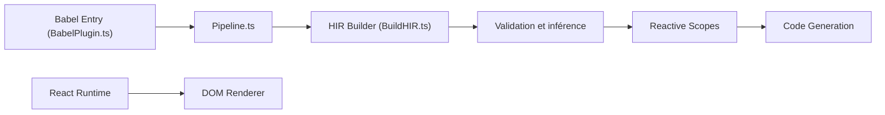

# facebook/react

> JavaScript library for building user interfaces from components, with an associated memoisation compiler.

## The problem
Updating a user interface by hand when state changes quickly leads to code that is hard to reason about. You want to declare the interface as a function of state and let the library compute the updates.

## What it actually does
You define components and state, React computes the updates and a renderer produces the output (browser, native, server). The graph also shows Server Components, an external store hook, DevTools and a compiler that goes from Babel code to an HIR representation, then to reactive scopes and to generated code. The README provided is truncated: it starts at "Installation", with no introduction and no install command.

## How it is wired


## Trying it
Excerpt from the README (JSX example), no install command in the part provided:
```bash
# Aucune commande documentée dans le README fourni.
# Le README renvoie à Quick Start et Create a New React App sur le site.
```

## Cost and gotchas
Free. The README does not give the install command here; you have to go through the website. The compiler is described as integrated separately, with engine paths not detailed in the graph.

## What it is not
It is not a full framework: no routing or data fetching described in this README. The link with the react/react repository (same README) is not explained.

## Alternatives
No alternative named in the README.

## For you
Ignore for a data/AI/MLOps profile unless you are building an application front end yourself: the library is mature, but it falls outside the pipeline and model scope.
