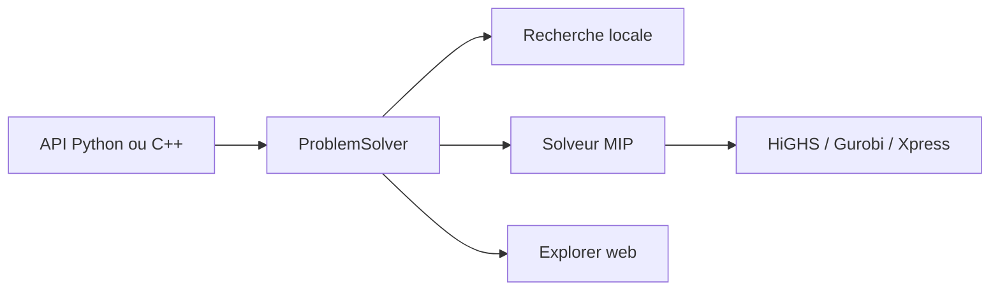

# facebook/rebalancer

> Assignment problem solver, in C++ with a Python interface, used in production at Meta.

## The problem
Distributing objects and containers (partitions across servers, tasks across hosts) under constraints requires reprogramming a solver each time.

## What it actually does
Describes the problem with predefined objectives and constraints (balance, capacity), then solves it by local search or mixed-integer programming (HiGHS, Gurobi, FICO Xpress). Handles about one million objects. A web explorer lets you inspect runs.

## How it is wired
Simplified diagram based on the sheet, no diagram provided.


## Trying it
```bash
pip install rebalancer
# puis l'exemple Python du README (ProblemSolver, CapacitySpec, LocalSearchSolverSpec)
```

## Cost and gotchas
Free with HiGHS; Gurobi and FICO Xpress are commercial. Building from source requires fbthrift and folly, which are heavy. The solver fits in memory on a single machine.

## What it is not
Not a machine learning tool: combinatorial optimization. Not distributed.

## Alternatives
No alternative named in the README, other than the HiGHS, Gurobi and FICO Xpress solvers it drives.

## For you
Worth watching: useful for placing workloads or models under constraints; test it on a real case before investing.
