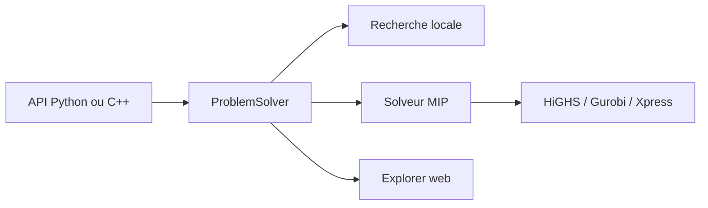

# facebook/rebalancer

> Solveur de problèmes d'affectation, en C++ avec interface Python, utilisé en production chez Meta.

## Le problème
Répartir objets et conteneurs (partitions sur des serveurs, tâches sur des hôtes) sous contraintes demande de reprogrammer un solveur à chaque fois.

## Ce que ça fait vraiment
Décrit le problème par des objectifs et contraintes prédéfinis (équilibre, capacité), puis le résout par recherche locale ou programmation mixte en nombres entiers (HiGHS, Gurobi, FICO Xpress). Traite environ un million d'objets. Un explorateur web inspecte les exécutions.

## Comment c'est branché
Schéma simplifié d'après la fiche, sans diagramme fourni.


## Essayer
```bash
pip install rebalancer
# puis l'exemple Python du README (ProblemSolver, CapacitySpec, LocalSearchSolverSpec)
```

## Coût et pièges
Gratuit avec HiGHS ; Gurobi et FICO Xpress sont commerciaux. La compilation depuis les sources exige fbthrift et folly, lourds. Le solveur tient en mémoire sur une seule machine.

## Ce que ce n'est pas
Pas un outil d'apprentissage automatique : de l'optimisation combinatoire. Pas distribué.

## Alternatives
Aucune alternative nommée dans le README, hors les solveurs HiGHS, Gurobi et FICO Xpress qu'il pilote.

## Pour toi
À surveiller : utile pour le placement de charges ou de modèles sous contraintes, à tester sur un cas réel avant d'investir.

