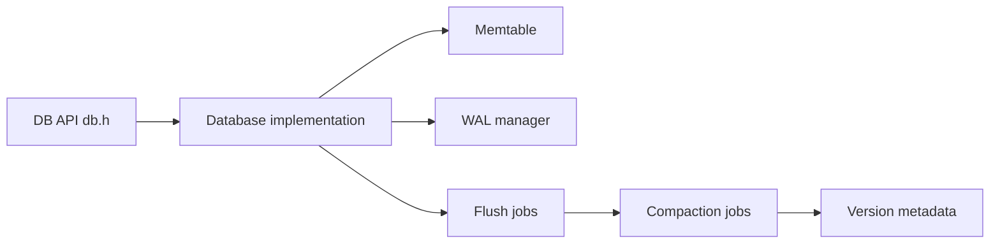

# facebook/rocksdb

> Embedded LSM-based key-value store, for holding large volumes on flash or in RAM.

## The problem
A local storage engine with strong write performance, tunable, that can be embedded in another service.

## What it actually does
C++ library derived from LevelDB: LSM tree, multi-threaded compactions, tunable trade-offs between write, read and space amplification. The public interface is in `include/` (the other headers are internal). The code also shows a memtable, WAL, blob files, block caches, a backup engine and a file-system abstraction.

## How it is wired

## Trying it
No command in the README: see the repository's `examples/` folder.

## Cost and gotchas
Free. C++ build; for Python or Java bindings, you need a third-party wrapper not documented here. GPL-2.0 license according to the catalog: read it before embedding in a closed product.

## What it is not
Not a standalone database: no server, no SQL. You have to write the code that uses it.

## Alternatives
- LevelDB: the original engine, cited in the README as the project's basis.

## For you
Worth watching: it serves as the storage engine for many data tools (indexes, databases, streaming), useful to know in order to understand what lies underneath, rarely to be used directly.
