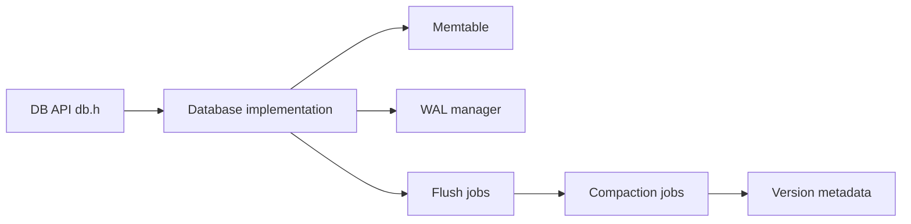

# facebook/rocksdb

> Magasin clé-valeur embarqué à structure LSM, pour stocker de gros volumes sur flash ou en RAM.

## Le problème
Un moteur de stockage local performant en écriture, ajustable, que l'on peut intégrer dans un autre service.

## Ce que ça fait vraiment
Bibliothèque C++ dérivée de LevelDB : arbre LSM, compactions multi-threads, compromis réglables entre amplification d'écriture, de lecture et d'espace. L'interface publique est dans `include/` (les autres en-têtes sont internes). Le code montre aussi memtable, WAL, fichiers blob, caches de blocs, moteur de sauvegarde et abstraction système de fichiers.

## Comment c'est branché

## Essayer
Aucune commande dans le README : voir le dossier `examples/` du dépôt.

## Coût et pièges
Gratuit. Compilation C++ ; pour des liaisons Python ou Java, il faut un wrapper tiers non documenté ici. Licence GPL-2.0 selon le catalogue : à lire avant d'embarquer dans un produit fermé.

## Ce que ce n'est pas
Pas une base de données autonome : pas de serveur, pas de SQL. Il faut écrire le code qui l'utilise.

## Alternatives
- LevelDB : le moteur d'origine, cité dans le README comme base du projet.

## Pour toi
À surveiller : il sert de moteur de stockage à nombre d'outils de données (index, bases, streaming), utile à connaître pour comprendre ce qu'il y a dessous, rarement à utiliser en direct.

