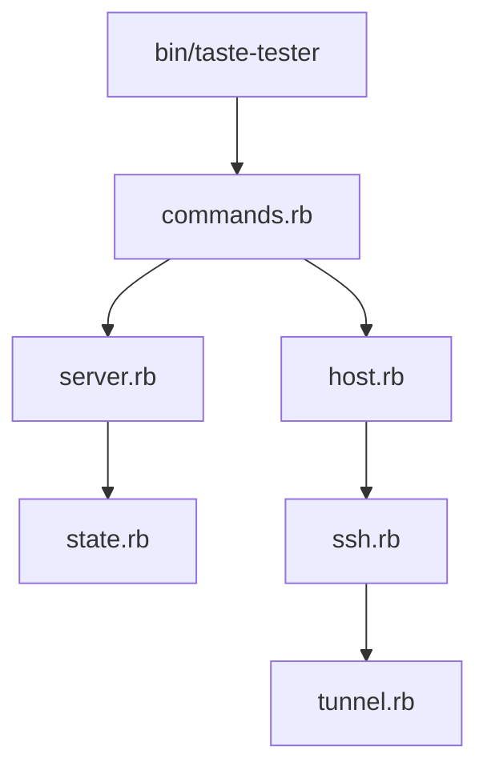

# facebook/taste-tester

> Tests Chef cookbook changes on real servers through a local chef-zero.

## The problem
Validating Chef infrastructure changes before production is risky without a test mode on a real host.

## What it actually does
Starts a local chef-zero server, uploads the repository to it, then connects to the remote host over SSH (and a reverse tunnel) to point it at that server. It remembers the git point of the last upload. The `taste-untester` script puts the host back in production after the delay (1 h by default). Ruby plugins add hooks.

## How it is wired
Diagram based on the code's diagram.



## Trying it
```bash
taste-tester impact
taste-tester test -s [host]
taste-tester upload
taste-tester untest [host]
```

## Cost and gotchas
Free. Requires a Chef fleet, passwordless SSH keys, `/etc/chef/client.rb` symlinks and a cron for `taste-untester`. Ruby and Chef are required (not in the prerequisites list).

## What it is not
Not a cookbook unit-testing tool: it actually modifies a server, which must be able to return to production safely.

## Alternatives
None cited in the README.

## For you
Ignore: Chef tooling for teams running a server fleet with that stack, unrelated to modern MLOps.
