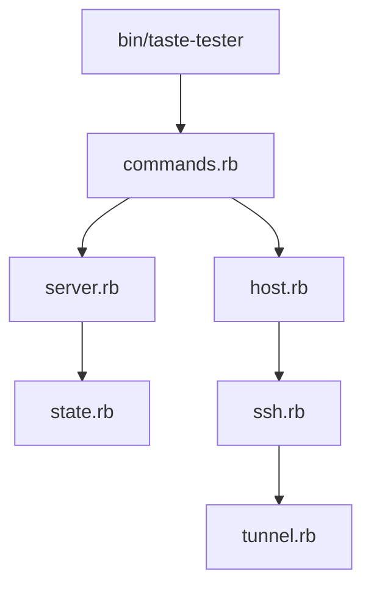

# facebook/taste-tester

> Teste des changements de cookbooks Chef sur de vrais serveurs via un chef-zero local.

## Le problème
Valider des modifications d'infrastructure Chef avant production est risqué sans mode test sur un hôte réel.

## Ce que ça fait vraiment
Lance un serveur chef-zero local, y téléverse le dépôt, puis connecte l'hôte distant par SSH (et tunnel inverse) pour le pointer vers lui. Il mémorise le point git du dernier envoi. Le script `taste-untester` remet l'hôte en production après le délai (1 h par défaut). Des plugins Ruby ajoutent des hooks.

## Comment c'est branché
Schéma d'après le diagramme du code.



## Essayer
```bash
taste-tester impact
taste-tester test -s [host]
taste-tester upload
taste-tester untest [host]
```

## Coût et pièges
Gratuit. Requiert un parc Chef, des clés SSH sans mot de passe, des symlinks `/etc/chef/client.rb` et un cron pour le `taste-untester`. Ruby et Chef sont nécessaires (hors liste des prérequis).

## Ce que ce n'est pas
Pas un outil de test unitaire de cookbooks : il modifie réellement un serveur, qui doit pouvoir revenir sans risque en production.

## Alternatives
Aucune citée dans le README.

## Pour toi
Ignorer : outillage Chef réservé aux équipes qui exploitent un parc de serveurs avec cette stack, sans rapport avec le MLOps moderne.

