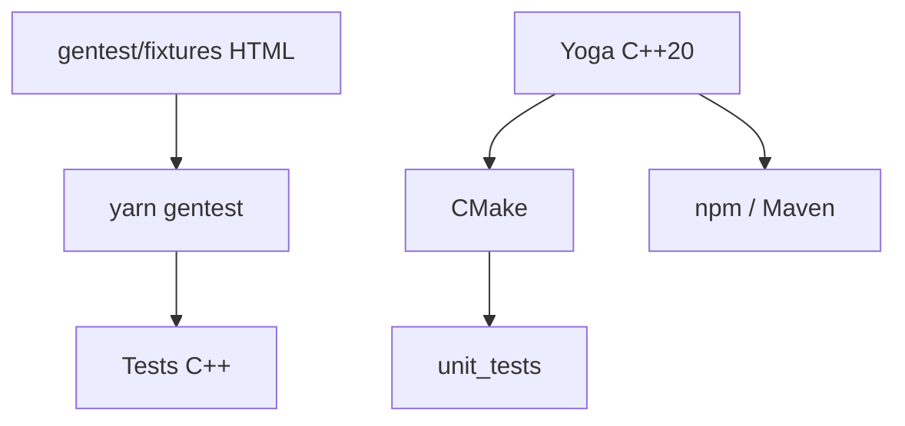

# facebook/yoga

> Embeddable flexbox layout engine in C++, with multi-language bindings, for UI developers.

## The problem
Computing a UI layout identically across several platforms without a browser.

## What it actually does
Implements flexbox in C++20, built with CMake. Bindings exist for several languages (`yoga-layout` npm and Maven packages). Many tests are generated from HTML fixtures rendered in Chrome.

## How it is wired
Simplified diagram based on the sheet, no diagram provided.



## Trying it
```bash
./unit_tests Debug
./unit_tests Release
yarn install
yarn gentest
```

## Cost and gotchas
Free. Requires a C++20 toolchain and CMake; ninja is optional. The generated tests require yarn classic.

## What it is not
Not a complete UI framework: only the layout computation. No usage documentation in the README.

## Alternatives
None named in the README.

## For you
Ignore: UI layout engine, unrelated to data / AI / MLOps work.
