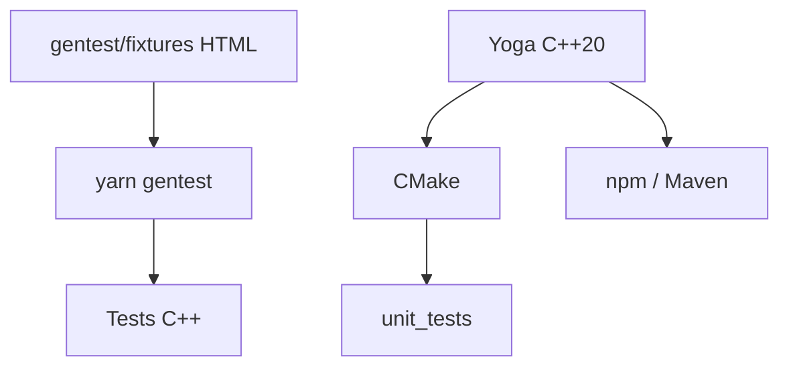

# facebook/yoga

> Moteur de mise en page flexbox embarquable en C++, avec liaisons multi-langages, pour développeurs d'interfaces.

## Le problème
Calculer la disposition d'une interface de façon identique sur plusieurs plateformes sans navigateur.

## Ce que ça fait vraiment
Implémente flexbox en C++20, construit avec CMake. Des liaisons existent pour plusieurs langages (paquets npm `yoga-layout` et Maven). Beaucoup de tests sont générés depuis des fixtures HTML rendues dans Chrome.

## Comment c'est branché
Schéma simplifié d'après la fiche, sans diagramme fourni.



## Essayer
```bash
./unit_tests Debug
./unit_tests Release
yarn install
yarn gentest
```

## Coût et pièges
Gratuit. Toolchain C++20 et CMake requise ; ninja facultatif. Les tests générés demandent yarn classic.

## Ce que ce n'est pas
Pas un framework d'interface complet : seulement le calcul de layout. Pas de documentation d'usage dans le README.

## Alternatives
Aucune nommée dans le README.

## Pour toi
À ignorer : moteur de layout d'interface, sans lien avec un travail data / IA / MLOps.

