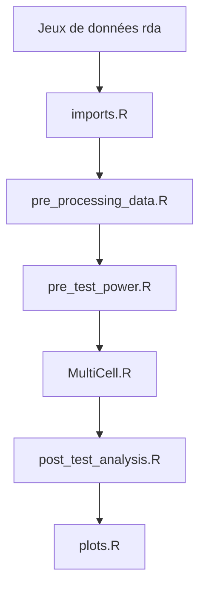

# facebookincubator/GeoLift

> R package for geo-level incrementality measurement using the synthetic control method, for marketing.

## The problem
Measuring the real effect of an advertising campaign by region requires choosing the test markets and controlling for bias.

## What it actually does
Data-driven market selection, statistical power calculators, inference and plots to analyze a test. A multi-cell mode and support for commuting zones exist. The analysis code relies on the augsynth package.

## How it is wired


## Trying it
```r
install.packages("remotes", repos='http://cran.us.r-project.org')
remotes::install_github("ebenmichael/augsynth")
remotes::install_github("facebookincubator/GeoLift")
```

## Cost and gotchas
Free, R 4.0.0 or later, with augsynth to be installed from GitHub before the package.

## What it is not
Not a media mix modeling tool: it measures geographic tests. Last push in June 2026, so still active.

## Alternatives
No alternative named in the README.

## For you
Worth watching: useful if you do causal inference or marketing measurement, in R.
